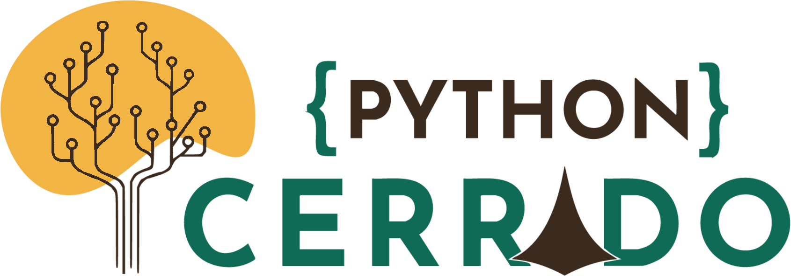

<p align="center">
  <picture>
    <source media="(prefers-color-scheme: dark)" srcset="../docs/pythoncerrado-2026-logo-dark.png">
    
  </picture>
</p>

# volto-pythoncerrado-site

[](https://github.com/plonegovbr/pythoncerrado-site/actions/workflows/main.yml)

Frontend do site da [Python Cerrado](https://pythoncerrado.org): o add-on Volto `volto-pythoncerrado-site`.

## O que o add-on faz

- Reúne os add-ons do site:
  - `@simplesconsultoria/volto-light-theme`, sobre o `@kitconcept/volto-light-theme` (o tema do Volto);
  - `@plone-collective/volto-techevent`, com os blocos e as visões de evento, grade, palestras, palestrantes e patrocinadores;
  - `@simplesconsultoria/volto-videos`, `@plone-collective/volto-image-editor` e `@plone/volto-form-block`.
- Carrega a fonte [Outfit](https://fonts.google.com/specimen/Outfit) (pesos 300 a 700, via [`@fontsource/outfit`](https://fontsource.org/fonts/outfit)), usada pelos três temas da edição 2026.

As cores vêm do tema escolhido no painel **Temas**, no backend. O add-on não define cores próprias.

O pacote não é publicado no npm. Ele existe para ser usado neste repositório.

## Desenvolvimento

O desenvolvimento usa workspaces do pnpm e o `mrs-developer` para trazer o código do Volto (`core/`). Funciona apenas com pnpm.

### Pré-requisitos ✅

-   Um [sistema operacional](https://6.docs.plone.org/install/create-project-cookieplone.html#prerequisites-for-installation) que atenda aos requisitos abaixo.
-   [nvm](https://6.docs.plone.org/install/create-project-cookieplone.html#nvm)
-   [Node.js e pnpm](https://6.docs.plone.org/install/create-project.html#node-js) 24
-   [Make](https://6.docs.plone.org/install/create-project-cookieplone.html#make)
-   [Git](https://6.docs.plone.org/install/create-project-cookieplone.html#git)
-   [Docker](https://docs.docker.com/get-started/get-docker/) (opcional)

### Instalação 🔧

1.  Clone o repositório e entre no diretório do frontend.

    ```shell
    git clone git@github.com:plonegovbr/pythoncerrado-site.git
    cd pythoncerrado-site/frontend
    ```

2.  Instale as dependências.

    ```shell
    make install
    ```

Execute `make help` para ver todos os comandos disponíveis.

### Subindo o ambiente

Inicie um backend. Pode ser o do diretório [`backend`](../backend/) (`make start` lá) ou um em Docker:

```shell
make backend-docker-start
```

Em outro terminal, inicie o frontend em http://localhost:3000/:

```shell
make start
```

### Lint e formatação

Executa ESLint, Prettier e Stylelint, só verificando (`lint`) ou corrigindo (`format`):

```shell
make lint
make format
```

### Traduções

Extrai as mensagens para os arquivos de tradução:

```shell
make i18n
```

### Testes unitários

```shell
make test
```

### Testes de aceitação (Cypress)

Execute cada passo em um terminal separado.

1.  Inicie o frontend em modo de desenvolvimento.

    ```shell
    make acceptance-frontend-dev-start
    ```

2.  Inicie o servidor de aceitação do backend.

    ```shell
    make acceptance-backend-start
    ```

3.  Abra o Cypress em modo interativo.

    ```shell
    make acceptance-test
    ```

### Storybook

```shell
make storybook-start
```

O Storybook fica em http://localhost:6006/.

## Licença

O projeto é distribuído sob a licença MIT.
